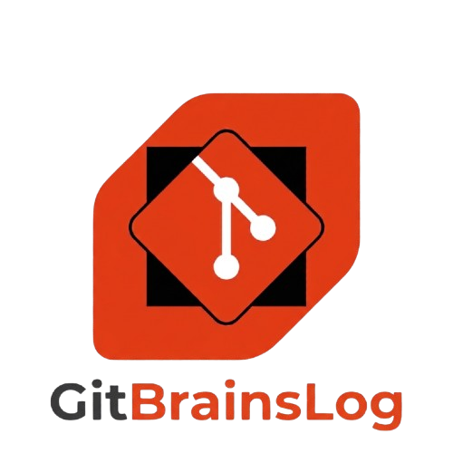
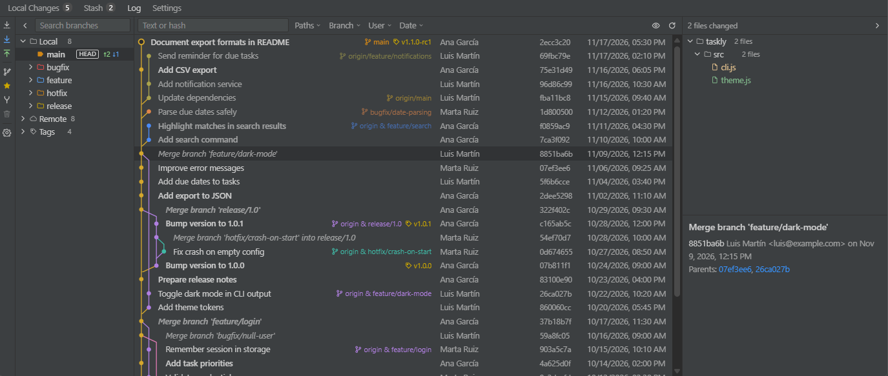
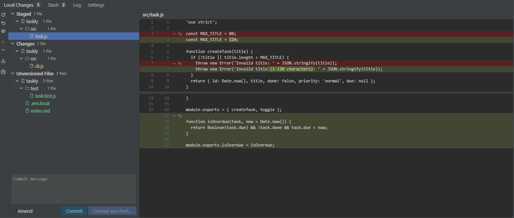
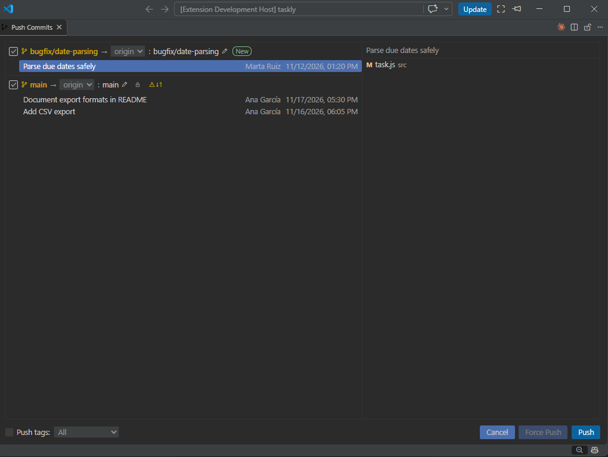
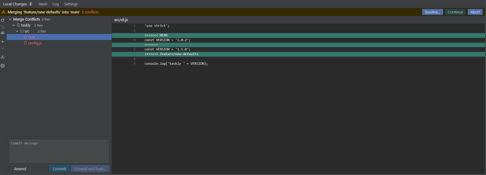
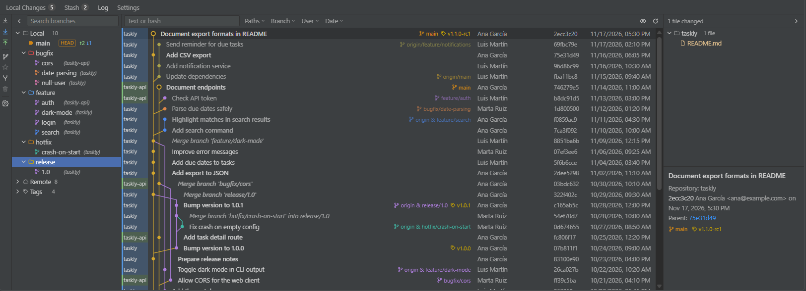
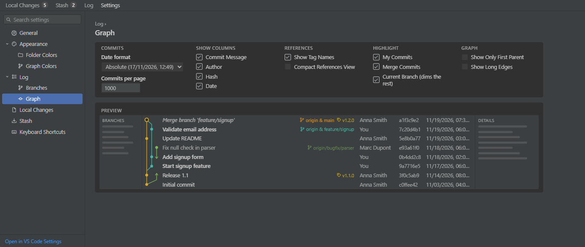

<p align="center">
  
</p>

# GitBrainsLog

La ventana **Git** de los IDE de JetBrains (IntelliJ, WebStorm, PyCharm…), dentro de VS Code.

Un panel inferior con el log de commits y su grafo, el árbol de ramas, los cambios locales, los stashes y los ajustes, con los mismos menús contextuales y casi los mismos gestos que en JetBrains. Usa los colores del tema activo de VS Code, claro u oscuro.



## Instalación

Necesitas **VS Code 1.85 o superior** y **Git** en el `PATH`.

Desde un archivo `.vsix`:

```bash
code --install-extension gitbrainslog-1.0.0.vsix
```

o en VS Code: *Extensions ▸ ⋯ ▸ Install from VSIX…*

## Empezar

1. Abre una carpeta con un repositorio Git (o con varios dentro).
2. Pulsa **Alt+9** (**Cmd+9** en macOS), como en JetBrains, o ejecuta *Show Git Log*. También está el icono **Git Log** en el panel inferior.
3. Cuatro pestañas, que se pueden reordenar arrastrándolas: **Local Changes**, **Stash**, **Log** y **Settings**.
4. Para tenerlo más grande, los iconos de la barra del panel lo abren en una **pestaña del editor** o en una **ventana nueva** (útil con un segundo monitor). Mientras tanto el panel inferior muestra un aviso con *Move Back Here*; cerrar la pestaña también lo devuelve al panel.

## Qué trae

### Log

- **Grafo de commits** con un color fijo por rama (el mismo en cada recarga y en todos los repos). Las aristas que unen commits muy lejanos se cortan con una flecha que, al pulsarla, salta al otro extremo, como en JetBrains.
- **Panel de ramas** con Local, Remote y Tags en árbol, indicadores ↑/↓, buscador, ramas favoritas (estrella) y ramas protegidas (candado). Doble clic en una rama filtra el log por ella.
- **Filtros** junto al buscador: *Branch*, *User*, *Date* y *Paths*. Se combinan y filtran en git, así que valen sobre todo el historial.
- **Detalles** del commit seleccionado: archivos cambiados (doble clic abre el diff), mensaje completo, autor y padres enlazados.
- **Menús contextuales** de commit (Cherry-Pick, Checkout Revision, Reset Current Branch to Here, Revert, Undo Commit, New Branch, New Tag, Create Patch…) y de rama (Checkout, Rebase, Merge, Update, Push, Rename, Delete, Compare…).
- **Varios commits a la vez**: Ctrl/Cmd+clic o Shift+clic y, con el clic derecho, *Cherry-Pick*, *Compare Versions*, *Squash*, *Fixup* y *Drop* (rebase interactivo sin salir de VS Code).
- **Barra de acciones**: Fetch, Pull, Push, Merge…
- El **ojo** (*View Options*) elige qué columnas ver y qué resaltar (tus commits, merges, rama actual).

### Local Changes



- Cambios agrupados en *Merge Conflicts*, *Staged*, *Changes* y *Unversioned Files*, por directorio y/o repositorio.
- **Auto-stage**, como JetBrains: los cambios de archivos con seguimiento entran solos en el commit; con «−» sacas uno y con «+» lo vuelves a meter. Se desactiva con `jbGit.autoStage`.
- **Vista previa** del cambio con las líneas modificadas resaltadas y, en cada bloque, botones para deshacerlo o pasarlo solo a *Staged* (commit parcial).
- Caja de commit con *Amend*, *Commit*, *Commit and Push* y Ctrl+Enter.
- *Rollback*, *Stash Changes*, y *Add to .gitignore* / *.git/info/exclude* para los archivos sin seguimiento.

### Stash

La lista de stashes con sus archivos (también los sin seguimiento) y *Pop*, *Apply* y *Drop*; el doble clic en un archivo abre el diff.

### Push



La ventana **Push Commits** de JetBrains: cada rama con los commits que subiría y sus archivos, remoto y rama de destino editables, aviso de rama nueva o rechazada, *Push tags* y *Force Push* (`--force-with-lease`, no permitido en ramas protegidas).

### Conflictos, rebase y merge



Si un rebase, merge, cherry-pick o revert se para, aparece una barra bajo las pestañas con el estado (*Rebasing 'feature' onto 'main' (2/5)*) y *Resolve…*, *Continue*, *Skip* y *Abort*. Cada conflicto se resuelve con un **visor de tres columnas** (lo tuyo · resultado · lo que llega), con el resultado editable, o con *Accept Yours* / *Accept Theirs*.

### Comparar e historial

- **Compare**: dos ramas, una rama con la actual, o una rama o commit con el árbol de trabajo, en una pestaña del editor con la lista de archivos y los dos lados con los cambios resaltados (F7 / Shift+F7 saltan entre diferencias).
- **Show History** de un archivo o una carpeta (clic derecho en el explorador, la pestaña o el editor): los commits que lo tocaron, siguiendo los renombrados, y su diff.

### Varios repositorios



Si la carpeta contiene varios repositorios (también submódulos y repos anidados), se muestran todos a la vez: el log los junta por fecha con una franja de color por repo, y las acciones sobre una rama común se aplican en todos. También funciona en **worktrees**.

### Settings



Una pestaña de ajustes organizada como la de JetBrains, con buscador: fuente y tamaño de la interfaz, colores de carpetas, ramas y tags, opciones del log, y **atajos de teclado configurables** para las acciones de los menús contextuales.

## Teclado

| Dónde | Atajo |
|---|---|
| Abrir el panel | Alt+9 (Cmd+9 en macOS) |
| Log | ↑/↓, PageUp/PageDown, ← hijo, → padre, Ctrl/Cmd+C copia el hash, Shift+F10 abre el menú |
| Árboles (ramas, archivos, cambios) | ↑/↓, ← →, Inicio/Fin, Enter, Shift+↑/↓ amplía la selección |
| Caja de commit | Ctrl+Enter |
| Visores de diferencias | F7 / Shift+F7 |

Los atajos de los menús contextuales se cambian en *Settings ▸ Keyboard Shortcuts*.

## Ajustes

Se editan en la pestaña **Settings** o en los ajustes de VS Code (`jbGit.*`).

| Ajuste | Por defecto | Qué hace |
|---|---|---|
| `jbGit.maxCommits` | `1000` | Commits que se cargan de una vez (100–10000). *Load more* trae más. |
| `jbGit.dateFormat` | `absolute` | Fecha en la tabla de commits: `absolute` o `relative`. |
| `jbGit.repositoryScanMaxDepth` | `2` | Niveles de subcarpetas en los que se buscan repositorios (0–5). |
| `jbGit.autoStage` | `true` | Añade al stage solos los cambios de archivos con seguimiento. |
| `jbGit.protectedBranches` | `["main", "master"]` | Ramas remotas que no se pueden borrar (llevan un candado). |
| `jbGit.branchColors` | `{}` | Color del carril de cada rama en el grafo, por nombre. |
| `jbGit.folderColors` | bugfix, feature, release, hotfix | Color del icono de cada carpeta del árbol de ramas. |
| `jbGit.tagColor` | `yellow` | Color de los tags. |
| `jbGit.fontFamily` | `""` | Fuente de la interfaz de la extensión. Vacío = la de VS Code. |
| `jbGit.fontSize` | `0` | Tamaño de la interfaz en px (8–32). 0 = el de VS Code. |
| `jbGit.shortcuts` | `{}` | Atajos de los menús contextuales. |

## Comandos

| Comando | Qué hace |
|---|---|
| *Show Git Log* (`jbGit.focus`) | Abre el panel (o la pestaña del editor, si está ahí). |
| *Open in Editor Tab* (`jbGit.openInEditor`) | Lleva el Log a una pestaña del editor. |
| *Open in New Window* (`jbGit.openInNewWindow`) | Lleva el Log a una pestaña en una ventana nueva. |
| *Move Back to Panel* (`jbGit.moveToPanel`) | Cierra la pestaña y devuelve el Log al panel inferior. |
| *Refresh* (`jbGit.refresh`) | Recarga el log. |
| *Show History* (`jbGit.showHistory`) | Historial de un archivo o carpeta (explorador, pestaña y editor). |

## Desarrollo

```bash
npm install
npm run compile      # o: npm run watch
npm test             # compila y ejecuta los tests (node --test)
npm run package      # genera el .vsix
```

Abre la carpeta en VS Code y pulsa **F5**: se abre una ventana *Extension Development Host* con la extensión cargada. Si solo cambian archivos de `media/`, basta *Developer: Reload Webviews*; si cambia `src/`, hay que recompilar y reiniciar la ventana.

| Carpeta | Contenido |
|---|---|
| `src/extension.ts` | Registra la vista, recibe los mensajes del webview y ejecuta las acciones git. |
| `src/git.ts` | Llama a `git` con `execFile` (nunca por una shell) y parsea su salida. |
| `src/graph.ts` | Asigna carriles y colores al grafo. |
| `src/core.ts` | Lógica pura, sin `vscode`, para poder probarla. |
| `src/merge.ts`, `src/compare.ts`, `src/dialog.ts` | Visor de conflictos, comparación e historial, y ventanas de diálogo. |
| `media/` | La interfaz del webview (JS plano, sin framework ni build) y sus estilos. |
| `src/test/` | Tests unitarios y de integración, con repos git temporales. |

## Licencia

MIT
